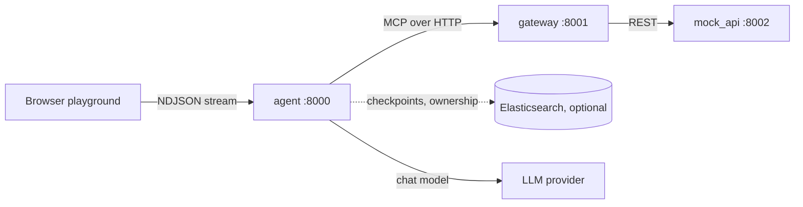

# mcp-agent-reference

A reference monorepo for an agent that works with a business system through MCP. A deep agent chats about a small CRM, calls an MCP gateway that wraps a mock REST API, streams NDJSON to a browser playground with a plan panel, and pauses for approval before any write.

## What it shows

- A FastMCP gateway with one sub-server per entity, mounted by prefix (`contacts_list`, `deals_move_stage`), 55-65 tools in total.
- Per-request MCP sessions that forward the user's token, so the API sees the real user.
- Tool binding on demand: the agent starts with a `search_tools` tool and the gateway tools are bound only when needed.
- Human in the loop: every write tool pauses the run until the user approves or rejects.
- Skills loaded from `agent/skills/`, and a read-only `researcher` subagent.
- Thread ownership: a thread belongs to the first user who sends a message on it.

## Architecture



| Package | Folder | Role |
| --- | --- | --- |
| `mock_crm` | `mock_api/` | FastAPI + SQLite CRM with seed data and two demo tokens |
| `crm_gateway` | `gateway/` | FastMCP server wrapping the REST API as tools |
| `crm_agent` | `agent/` | FastAPI + deepagents, streaming endpoint and playground |

See [docs/architecture.md](docs/architecture.md) for each pattern with file links.

## Quickstart

```bash
cp .env.example .env        # set OPENAI_API_KEY and GATEWAY_SECRET
docker compose up --build
```

Open <http://localhost:8000>. The playground token field defaults to `demo-token-alice`; `demo-token-bob` is the second user. The model defaults to `openai:gpt-5.4-nano` and is set with `MODEL`. The LLM key is read from the environment only.

Without Docker, with [uv](https://docs.astral.sh/uv/):

```bash
uv sync --all-packages --all-extras
DB_PATH=crm.db uv run python -m mock_crm                                                  # :8002
API_BASE_URL=http://localhost:8002 GATEWAY_SECRET=change-me uv run python -m crm_gateway  # :8001
GATEWAY_SECRET=change-me uv run python -m crm_agent                                       # :8000
```

## Stream events

`POST /chat/stream` with header `Authorization: Bearer <token>` and body `{"thread_id": "...", "message": "..."}` returns `application/x-ndjson`. Each line is `{"type": ..., "content": ...}`.

| Type | Content |
| --- | --- |
| `start` | Empty. First line of every stream. |
| `token` | A chunk of the agent's answer. |
| `think` | A chunk of text from a subagent. |
| `plan` | The todo list, one `[status] item` per line, sent only when it changes. |
| `interrupt` | JSON string of `[{"name", "args"}]`: writes waiting for approval. |
| `error` | A short message. The stream ends after it. |

Tool calls and tool results are never streamed.

Errors that happen before the stream: `401` for a missing or malformed `Authorization` header, `403` for a thread owned by another user, `409` for a resume with no pending interrupt (or a new message while one is pending).

## Human in the loop

1. The model calls a write tool (`create`, `update`, `delete`, `move`, `merge`, `complete`).
2. The run pauses and the stream ends with an `interrupt` line listing the pending calls.
3. The client sends `{"thread_id": "...", "resume": {"decision": "approve"}}` or `{"decision": "reject", "message": "..."}`.
4. On approve the tool runs and the stream continues; on reject the model gets the message and the tool never runs.

## Tool binding

The gateway exposes about 60 tools, which is a lot to put in every model call. The agent uses [langgraph-dynamic-tool-binding](https://github.com/longntl-namitech/langgraph-dynamic-tool-binding): the model sees `search_tools`, asks for what it needs, and only the matching tools are bound for the next calls.

## Elasticsearch mode

By default checkpoints and thread ownership live in memory. To persist them, start Elasticsearch and point the agent at it with [langgraph-checkpoint-elasticsearch](https://github.com/longntl-namitech/langgraph-checkpoint-elasticsearch):

```bash
docker compose --profile es up -d es
ES_URL=http://localhost:9200 GATEWAY_SECRET=change-me uv run python -m crm_agent
```

## Tests

```bash
uv sync --all-packages --all-extras
uv run pytest -q -m "not es"     # no network, no LLM
ES_URL=http://localhost:9200 uv run pytest -q -m es
uv run ruff check . && uv run ruff format --check .
```

The tests use a scripted chat model, so no API key is needed. `tests/test_e2e_stack.py` runs the mock API and the gateway on real ports and drives the agent through the real MCP client.

## Versions

Resolved by `uv.lock` on 2026-11-13: deepagents 0.7.37, fastmcp 3.4.11, mcp 1.30.0, langchain-mcp-adapters 0.3.2, langgraph 1.2.21, langchain 1.5.0. `mcp` is pinned below 2 because langchain-mcp-adapters does not support it yet. Details in [docs/versions.md](docs/versions.md).

## Not production

This is a teaching reference. Tokens are fixed demo strings, the mock API has no real auth, the gateway uses one shared secret, the playground renders model output as Markdown without sanitizing, and there is no rate limiting or audit log.

## License

MIT
